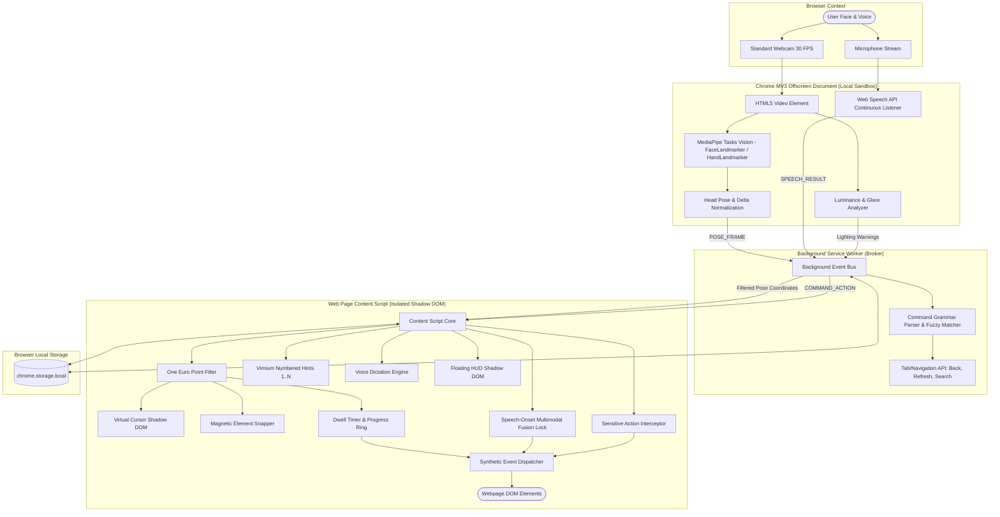

# Handsfree Technical Architecture

Handsfree is a Manifest V3 browser extension and companion accessibility suite designed for the CRCE Bit N Build Hackathon. It enables mouse-free web navigation using standard webcams and microphones with **zero remote cloud dependencies** for computer vision.

---

## 1. System Architecture Diagram



---

## 2. Subsystem Breakdown

### A. Offscreen Media Pipeline (`src/offscreen/`)
- **Reasoning**: Chrome Manifest V3 service workers cannot access `navigator.mediaDevices.getUserMedia`. Handsfree utilizes `chrome.offscreen.createDocument` with reasons `USER_MEDIA` and `AUDIO_PLAYBACK`.
- **Vision Pipeline**: Runs Google MediaPipe Tasks Vision (`FaceLandmarker` and `HandLandmarker`) inside WebAssembly. Extracts 3D coordinates for nose tip, eye corners, forehead, and chin to construct normalized yaw/pitch head rotation signals.
- **Resilient Fallback**: If WebAssembly assets face network latency or device GPU bottlenecks, a local algorithmic optical/color clustering tracker activates seamlessly.
- **Lighting Diagnostic**: Samples canvas luminance every 30 frames; generates user warnings if ambient lighting drops below threshold or if backlighting causes overexposure.
- **Speech Recognition**: Leverages `webkitSpeechRecognition` with continuous listening and interim results.

### B. Background Service Worker (`entrypoints/background.ts`)
- **Role**: Coordinates offscreen document lifecycle, relays messages between active browser tabs and popups, handles global keyboard commands (`Alt+Shift+H`, `Alt+Shift+C`, `Alt+Shift+M`).
- **Command Parser (`src/background/commands.ts`)**:
  - Normalizes speech (stripping conversational fillers like "please", "can you", "uh").
  - Matches 40+ speech commands across pointer, scrolling, browser navigation, tab management, hint overlays, and dictation.
  - Features Levenshtein similarity fuzzy matching (threshold 0.78) for high recognition tolerance in noisy rooms.
  - Direct execution of browser APIs (`chrome.tabs.goBack`, `chrome.tabs.reload`, `chrome.tabs.update`, `chrome.tabs.create`).

### C. Content Script & Shadow DOM Overlay (`entrypoints/content.ts`)
- **DOM Isolation**: Both the Virtual Cursor (`#handsfree-cursor-root`) and Heads-Up Display (`#handsfree-hud-root`) are attached directly to `document.documentElement` inside **closed Shadow DOMs**. Host website CSS stylesheets cannot alter cursor geometry, colors, or positioning.
- **One Euro Filter (`src/shared/oneEuro.ts`)**: Speed-adaptive low-pass filtering. When the head is still, cutoff frequency lowers to 1.0 Hz to eliminate physiological micro-tremors. When the head rotates quickly, cutoff dynamically increases with acceleration, maintaining under 16ms latency.
- **Magnetic Snap & Safe Selection**:
  - Automatically identifies interactive targets (`a`, `button`, `input`, `select`, `textarea`, `[role=button]`) within a 35px radius.
  - Magnetic pull guides the cursor toward the center of targets.
  - Dwell selection fills a circular SVG progress ring for 800ms before firing.
  - A 600ms cooldown prevents accidental double-clicking.
- **Sensitive Action Guard (`src/content/actions.ts`)**:
  - Intercepts clicks matching `/buy|purchase|pay|delete|remove|destroy|submit|confirm|checkout/i`.
  - Halts automatic activation and displays an on-screen dialog requiring spoken confirmation ("yes") or cancellation ("no").
- **Multimodal Fusion (`src/content/fusion.ts`)**:
  - Captures the exact target element at the onset of speech.
  - Activates the intended button even if head rotation drifts during the spoken word.
- **Numbered Hints (`src/content/hints.ts`)**:
  - Overlays high-contrast badges (1..N) over all viewport clickable targets on command ("show hints").
  - Executes instant click on spoken number ("click 7").
- **Voice Dictation (`src/content/dictation.ts`)**:
  - Injects spoken text into active form elements.
  - Invokes native property descriptors and dispatches synthetic `input` and `change` events so modern reactive frameworks (React, Vue, Angular) register state updates.
  - Supports spoken edits: "new line", "delete last word", "clear field", "select all".

---

## 3. Storage & Configuration
Settings and calibration profiles are persisted exclusively inside `chrome.storage.local`:
```typescript
interface HandsfreeSettings {
  enabled: boolean;
  mode: 'head' | 'hand' | 'eye';
  sensitivity: number;        // Multiplier: 0.5 - 3.0
  deadZone: number;           // Dead zone percentage around neutral
  dwellMs: number;            // Dwell duration (400 - 2000 ms)
  tolerancePx: number;        // Dwell tolerance radius (px)
  snapRadius: number;         // Magnetic snap radius (px)
  cursorSize: number;         // Cursor diameter (px)
  smoothingBeta: number;      // OneEuroFilter beta
  smoothingMinCutoff: number; // OneEuroFilter minCutoff
  soundFeedback: boolean;     // Web Audio synthesized sound
  highContrast: boolean;      // High visibility mode
  calibration: CalibrationProfile;
}
```
