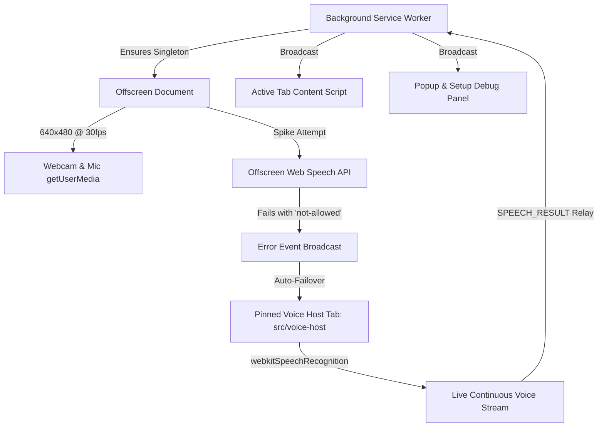

# Architectural Decisions Record (ADR)

## ADR-001: Media Pipeline & Speech Recognition Feasibility Spike

- **Date:** October 2026
- **Status:** Accepted & Implemented
- **Components:** `src/offscreen`, `src/setup`, `src/voice-host`, `src/background`

---

### 1. Context and Problem Statement

Handsfree requires two concurrent sensory streams to deliver touchless browser navigation without specialized hardware:

1. **Video Stream:** Webcam capture (640x480 @ 30fps) for facial landmark tracking and head pose estimation.
2. **Audio Stream:** Continuous microphone audio capture for real-time speech command recognition (e.g., "click", "scroll up", "recalibrate").

In Manifest V3 (MV3), background service workers have no access to the DOM or `navigator.mediaDevices.getUserMedia`. Google Chrome introduced the `chrome.offscreen` API (`USER_MEDIA`, `AUDIO_PLAYBACK` reasons) to host media capture and compute-heavy WebAssembly/ML pipelines outside the visible tab tree.

However, the feasibility of hosting the **Web Speech API (`webkitSpeechRecognition`)** inside an MV3 offscreen document was uncertain due to Chromium security and renderer architecture constraints.

---

### 2. Feasibility Spike Experiment: Web Speech API in Offscreen Documents

#### Experiment Setup

Inside `src/offscreen/index.ts`:

- Requested camera and microphone streams via `getUserMedia({ video: { width: 640, height: 480, frameRate: { ideal: 30 } }, audio: true })`.
- Initialized `new webkitSpeechRecognition()` with `continuous = true` and `interimResults = true`.
- Attached listeners for `onstart`, `onaudiostart`, `onspeechstart`, `onspeechend`, `onaudioend`, `onresult`, `onerror`, and `onend`.
- Relayed all telemetry and error codes to the background message bus and setup debug panel.

#### Spike Findings

1. **Webcam & Audio Capture:**
   - `getUserMedia` succeeds inside the offscreen document once permissions are granted on the extension origin.
   - Video elements correctly stream at `640x480` ideal `30fps`.
2. **Web Speech API (`webkitSpeechRecognition`):**
   - In Chromium's architecture, `webkitSpeechRecognition` delegates to `SpeechRecognitionDispatcherHost` in the browser process.
   - Offscreen documents lack a visible `WebContents` and top-level user activation context. As a result, calling `recognition.start()` triggers `onerror` with error code:
     ```text
     "not-allowed" (or "audio-capture")
     ```
   - Chromium explicitly restricts speech recognition bindings in offscreen contexts (see Chromium Issue 1413203).

---

### 3. Evaluated Fallback Alternatives

| Criteria                 | Option A: Pinned Voice Host Page (`src/voice-host`) | Option B: Vosk-browser (WASM + Model)               |
| :----------------------- | :-------------------------------------------------- | :-------------------------------------------------- |
| **Engine**               | Native Web Speech API (`webkitSpeechRecognition`)   | Offline Vosk Kaldi WASM engine                      |
| **Bundle Size Overhead** | **0 MB** (built into browser)                       | **~40 MB – 50 MB** (requires bundled model weights) |
| **Startup Latency**      | Instant (< 50ms)                                    | 2–5 seconds (WASM compile + model load)             |
| **CPU / Memory Usage**   | Negligible (native OS/browser speech dispatcher)    | Significant (~150MB RAM + continuous WASM DSP)      |
| **Recognition Accuracy** | High (native language acoustic models)              | Moderate (small English acoustic model)             |
| **MV3 Compatibility**    | Fully supported in pinned extension tab             | Supported in offscreen document                     |

---

### 4. Decision: Dual-Path Architecture with Intelligent Fallback

We decided on a **Dual-Path Architecture**:



1. **Offscreen Document (`src/offscreen`):**
   - Created on demand by the background worker using reasons `USER_MEDIA` and `AUDIO_PLAYBACK`.
   - Captures the 640x480 30fps video stream and audio.
   - Retains the spike test runner to log telemetry directly to the setup debug panel.
2. **Pinned Voice Host (`src/voice-host`):**
   - Automatically opened by the background service worker when offscreen speech restrictions are detected.
   - Runs `webkitSpeechRecognition` with `continuous: true` and `interimResults: true` in an extension tab with full renderer privileges.
   - Includes automatic restart resilience if Chrome's speech silence timer triggers.
   - Relays `SPEECH_RESULT` and `SPEECH_SPIKE_EVENT` back across the central message bus.
3. **First-Run Setup Page (`src/setup`):**
   - Displays live camera preview and audio level meter.
   - Provides clear permission recovery instructions if access was denied.
   - Houses a real-time debug panel showing offscreen status, speech spike error codes, and live speech transcripts as words are spoken.

---

### 5. Verification Checklist

- [x] Initial install auto-opens `setup.html`.
- [x] Camera preview displays active 640x480 stream.
- [x] Mic level meter reacts dynamically to user voice input.
- [x] Storage stores `permissionsGranted: true`.
- [x] Background manages singleton offscreen document (`chrome.offscreen.hasDocument`).
- [x] Offscreen status reports `running` to background.
- [x] Spike logs offscreen attempt and error details in real-time.
- [x] Voice Host captures spoken words and streams live transcripts to setup debug panel.
- [x] Popup toggle button and `Alt+Shift+H` shortcut start and stop the media pipeline.

---

## ADR-002: Head Tracking and Virtual Cursor Pipeline

- **Date:** October 2026
- **Status:** Accepted & Implemented
- **Components:** `src/offscreen`, `src/shared/oneEuro.ts`, `src/content`, `src/background`

### 1. Vision Engine & Local Bundling

- Loaded `@mediapipe/tasks-vision` inside the extension's offscreen document with zero CDN dependencies.
- Bundled the `face_landmarker.task` model file (3.7MB) and `vision_wasm_internal.*` binaries directly inside `public/mediapipe/`.
- Configured dynamic GPU delegate initialization with automatic, non-crashing CPU delegate fallback.

### 2. Pose Estimation & Signal Conditioning

- Detection executes per video frame via `requestVideoFrameCallback`, strictly capped at 30fps.
- Signal extracts Landmark 1 (nose tip) and computes 3D Euler angles (yaw, pitch) from the 4x4 facial transformation matrix.
- Head pose fuses rotational yaw/pitch (65%) and translational nose movement (35%) into normalized signals bounded roughly within [-1, 1].
- Applied an adaptive `OneEuroFilter` per axis (`minCutoff = 1.0`, `beta = 0.007`, `dCutoff = 1.0`) to eliminate stationary jitter while preventing lag during rapid movements.

### 3. Cursor Mapping & Safety Gating

- Relative-gain model: `cursorDelta = gain * (pose - neutralPose)` with a 2.5% dead zone around calibrated neutral and a 1.4 exponent power curve.
- Confidence gating: when confidence is low or no face is detected, the cursor instantly freezes and the HUD renders `"Face lost: look at the camera"`.
- If face tracking remains lost continuously for 3 seconds, the pipeline automatically auto-pauses tracking.
- Virtual cursor and HUD are isolated inside a closed Shadow DOM (`pointer-events: none`, `z-index: 2147483647`). Sub-frame iframes forward coordinates to `window.top` to guarantee seamless navigation across complex web pages.

--## ADR-003: Head Tracking Motion Model, Re-centering, and Drift Detection

- **Date:** October 2026
- **Status:** Updated (Calibration Overlay & Calibration Test Steps Removed; Direct Ergonomic Deflection Retained)
- **Components:** `src/shared/quickTourUI.ts`, `src/shared/overlay.ts`, `src/offscreen`, `src/setup`, `src/popup`

### 1. Motion Mapping Architecture

To provide instant, friction-free browser control without requiring repetitive multi-step calibration tests:

1. **Automatic Center Origin:**
   - When head tracking starts or face is acquired, the neutral center is automatically captured.
   - Zero-overhead dynamic zeroing: immediate control on first face frame.
2. **Ergonomic Head Deflection:**
   - Dead zone of 2.0% around neutral eliminates resting micro-tremor.
   - Smooth non-linear power curve ensures micro-adjustments are pixel-precise while comfortable head turns steer across the full screen.
   - Sensitivity setting provides direct user control without calibration wizard steps.

### 2. Sub-Second Posture Re-centering

- Triggered via:
  1. Keyboard shortcut `Alt+Shift+C` (both global manifest command and in-page keydown).
  2. Voice command `"center"` or `"recenter"`.
  3. Interactive Corner HUD button and Drift Toast button.
- Updates `neutralPose` to the current filtered head position and centers cursor $(0.5, 0.5)$ in $< 50\text{ ms}$, accompanied by visual confirmation feedback.

### 3. Continuous Edge Drift Detection

- Monitors if the virtual cursor remains pinned within 3px of any screen boundary.
- If continuously pinned for $\ge 4$ seconds, displays an alert HUD toast:
  $$\text{"Drifted? Say 'center' or press Alt+Shift+C"}$$
- Toast automatically dismisses upon cursor movement or re-centering.
